# 🤖 Avatar Slicer & Bot Generator

> Slice any multi-avatar image / sprite sheet into individual bot avatars, or generate fresh procedural AI bot avatar sheets on the fly. 100% client-side, zero backend required.

🔗 **Live Web Application**: [https://rifaterdemsahin.github.io/avatars/](https://rifaterdemsahin.github.io/avatars/)

---

## 📸 16 Sliced Bot Avatars (`avatars/`)

Generated directly from [`assets/sample_avatar.jpeg`](file:///Users/rifaterdemsahin/projects/avatar/assets/sample_avatar.jpeg) into 16 individual 512×512 PNG images:

| Avatar | Filename | Codename | Dimensions | Link |
|:---:|:---|:---|:---:|:---|
| 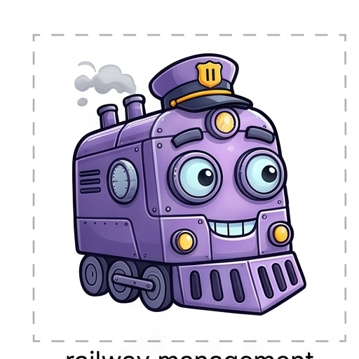 | `bot-01.png` | Aegis | 512×512 | [View](avatars/bot-01.png) |
| 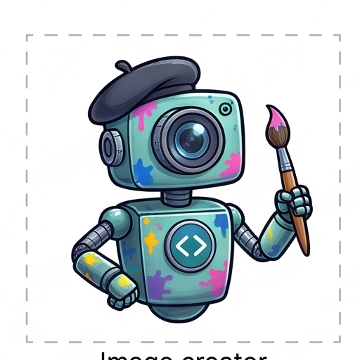 | `bot-02.png` | Nexus | 512×512 | [View](avatars/bot-02.png) |
| 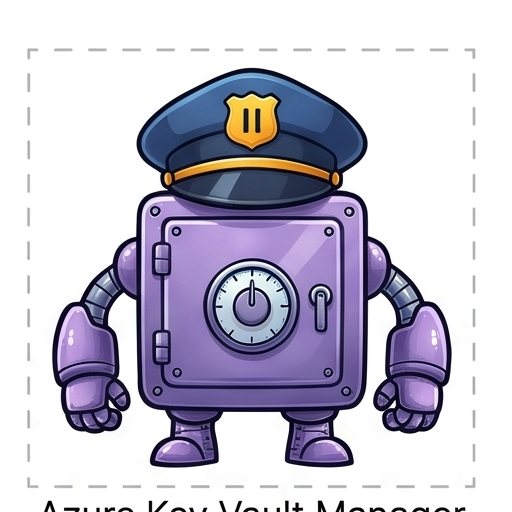 | `bot-03.png` | Echo | 512×512 | [View](avatars/bot-03.png) |
| 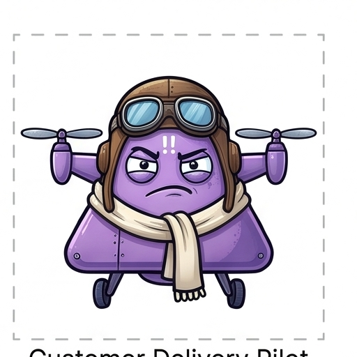 | `bot-04.png` | Vortex | 512×512 | [View](avatars/bot-04.png) |
| 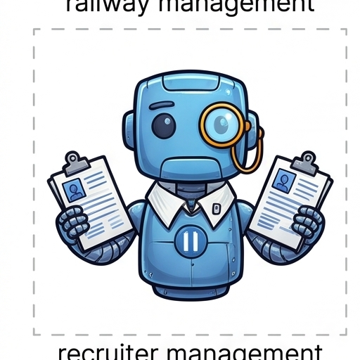 | `bot-05.png` | Cypher | 512×512 | [View](avatars/bot-05.png) |
| 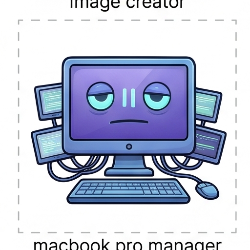 | `bot-06.png` | Zenith | 512×512 | [View](avatars/bot-06.png) |
| 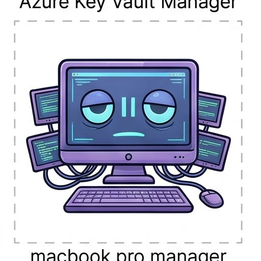 | `bot-07.png` | Pulse | 512×512 | [View](avatars/bot-07.png) |
| 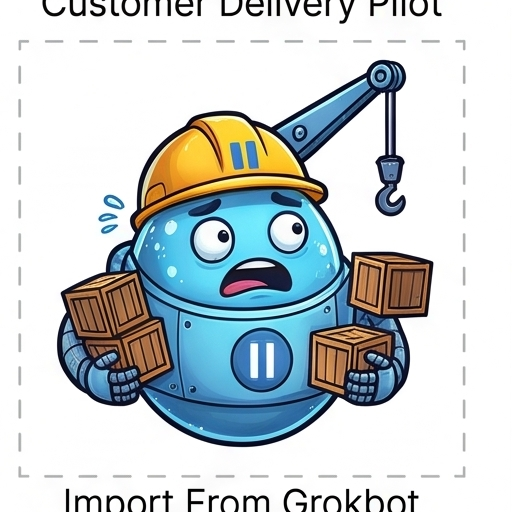 | `bot-08.png` | Specter | 512×512 | [View](avatars/bot-08.png) |
| 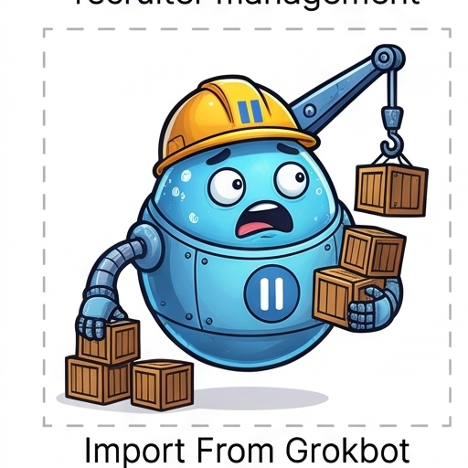 | `bot-09.png` | Orion | 512×512 | [View](avatars/bot-09.png) |
| 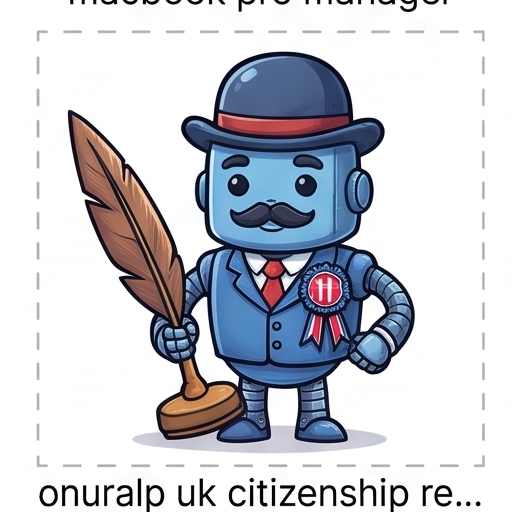 | `bot-10.png` | Titan | 512×512 | [View](avatars/bot-10.png) |
| 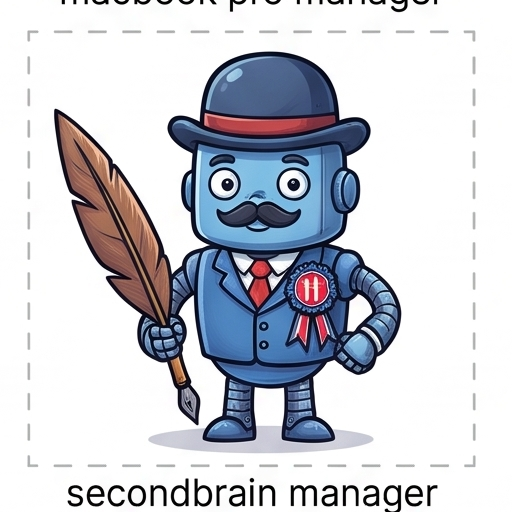 | `bot-11.png` | Apex | 512×512 | [View](avatars/bot-11.png) |
| 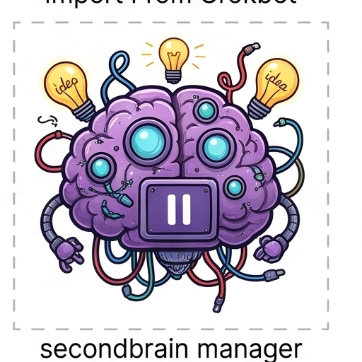 | `bot-12.png` | Vector | 512×512 | [View](avatars/bot-12.png) |
| 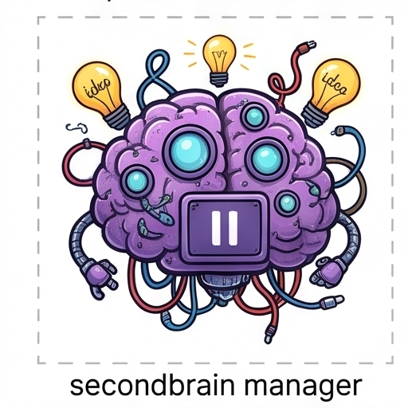 | `bot-13.png` | Nova | 512×512 | [View](avatars/bot-13.png) |
| 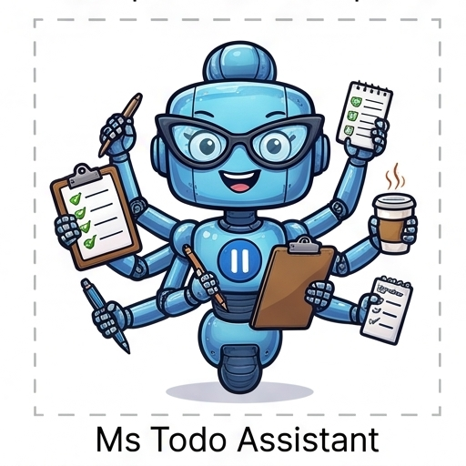 | `bot-14.png` | Glitch | 512×512 | [View](avatars/bot-14.png) |
| 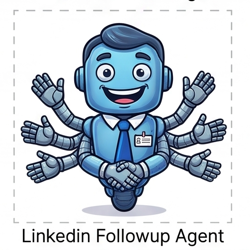 | `bot-15.png` | Spark | 512×512 | [View](avatars/bot-15.png) |
|  | `bot-16.png` | Quantum | 512×512 | [View](avatars/bot-16.png) |

Full metadata manifest available in [`avatars/manifest.json`](avatars/manifest.json).

---

## ✨ Features

- **Precision 4×4 & Custom Grid Slicing**: Effortlessly cut sheets into any NxM grid (2×2, 3×3, 4×4, 5×5, etc.).
- **Interactive Cut Overlays**: Live coordinates, bounding box previews, and margin/gutter controls.
- **Procedural Bot Generator**: Client-side canvas robot generator with varied visors, antennas, LED matrices, and palettes.
- **Instant Export**:
  - One-click **Download All as ZIP**.
  - Direct individual file download (PNG, WebP, JPEG).
  - Copy directly to clipboard as PNG blob.

---

## 🛠️ CLI Slicing Script

To re-slice any 4×4 sheet from the command line:

```bash
python3 scripts/slice_avatars.py
```

To re-generate the 3×3 procedural sample sheet:

```bash
python3 scripts/generate_sample_sheet.py
```

---

## 🚀 Local Development

```bash
# Serve locally on port 30090
python3 -m http.server 30090

# Open in Google Chrome
open -a "Google Chrome" http://localhost:30090
```

---

## 🌐 Live GitHub Pages
[https://rifaterdemsahin.github.io/avatars/](https://rifaterdemsahin.github.io/avatars/)
